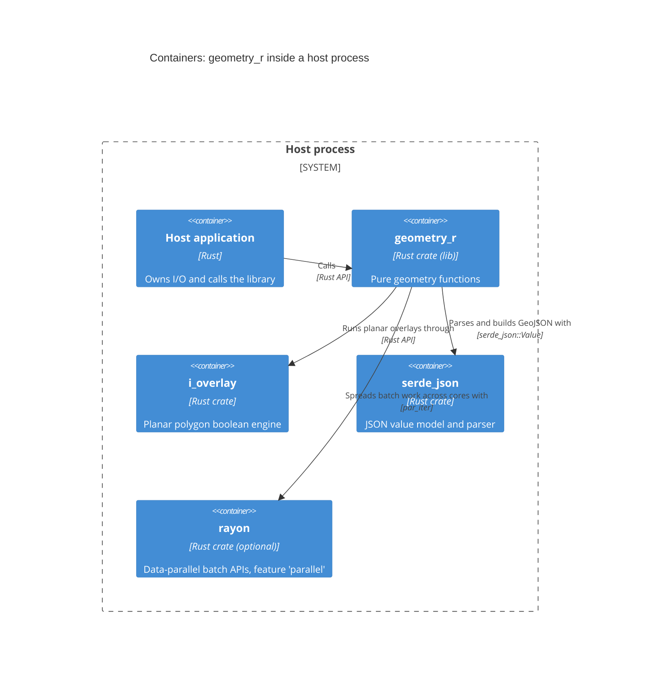

# C4 Level 2: Containers

geometry_r is a single container: one Rust crate compiled into the host binary.
The diagram shows it with the third-party crates it is built on.

**Elements**

| Element | Technology | Notes |
|---|---|---|
| geometry_r | Rust 1.81 library | Modules listed in [3-components.md](3-components.md). |
| i_overlay | Rust crate 1.10 | Used only through `polygon::boolean` and `polygon::antimeridian`, behind the orientation adapter in `polygon::planar`. |
| serde_json | Rust crate 1.x | Used only by `geojson`. |
| rayon | Rust crate 1.10 (optional) | Used only by `batch::par`. |
| thiserror | Rust crate 1.x | Derives `GeoError` at compile time; not shown. |
