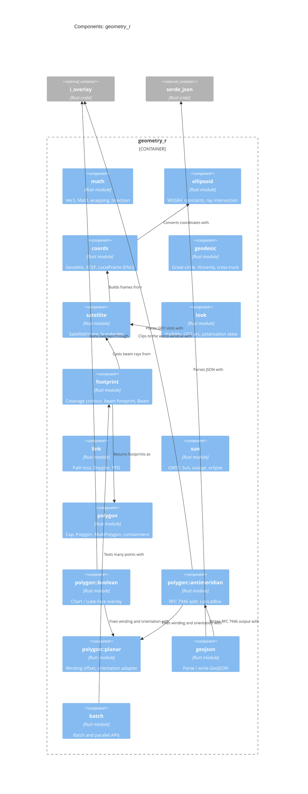

# C4 Level 3: Components of geometry_r

The crate's modules and their main dependencies. Names match the code
(`src/<module>.rs`, `src/polygon/<module>.rs`).

`math` and `error` are used by every module and are left out of the arrows.
